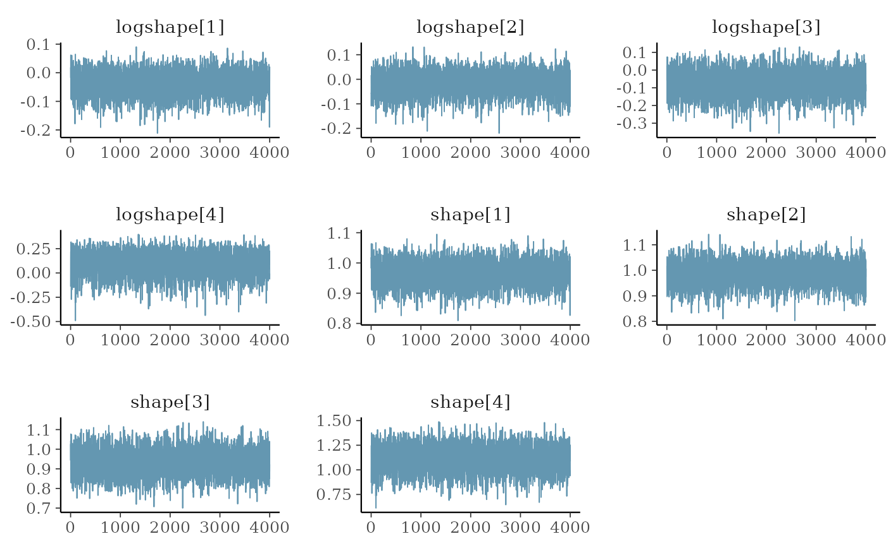
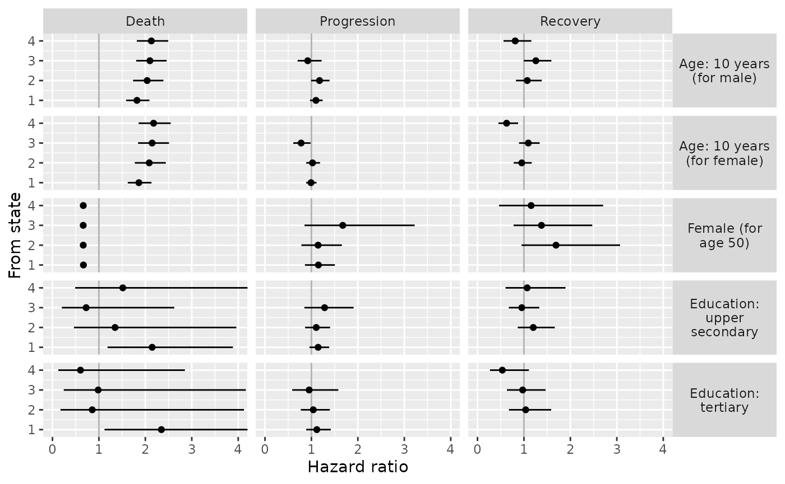
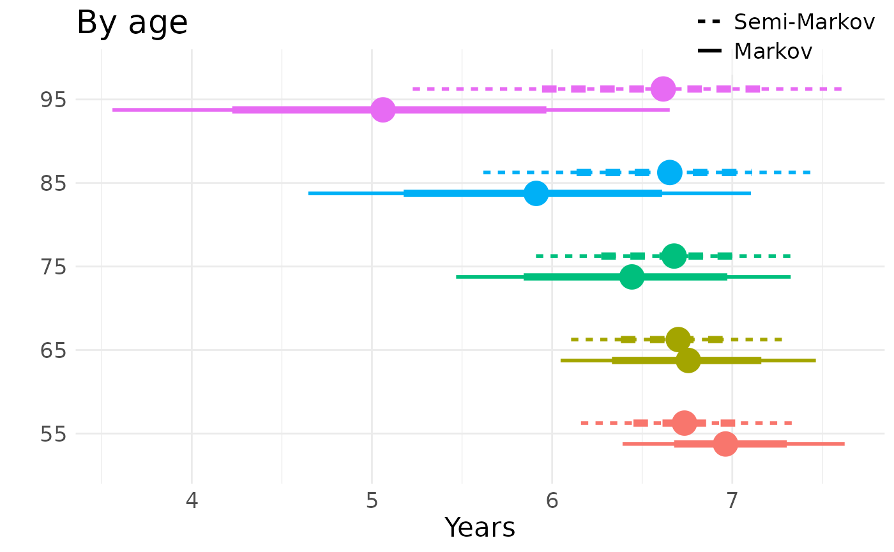
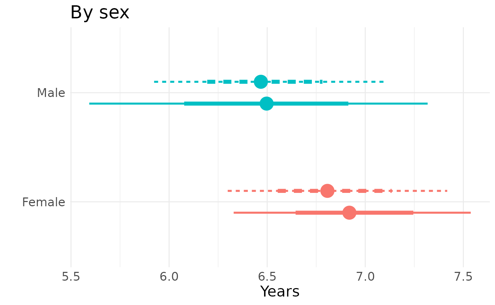
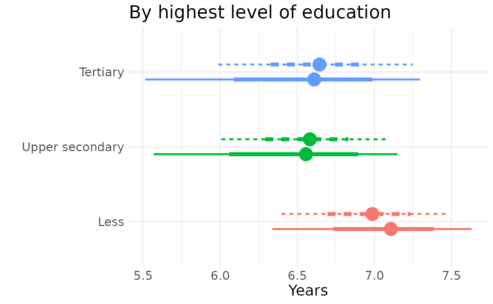
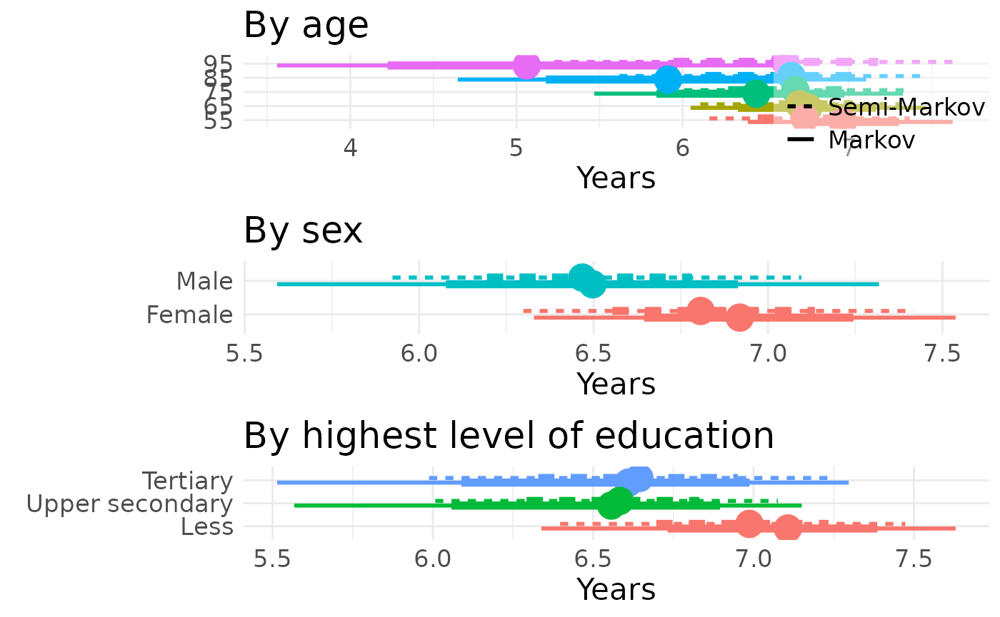

# Code for using the msmbayes package for semi-Markov modelling in an application to cognitive function

This file gives the code used for the analysis of the cognitive function
data in Section 6 of the paper “Stable and practical semi-Markov
modelling of intermittently-observed data” (Jackson).

It is intended to show that the methodology in the paper and the
`msmbayes` package can be easily used in practice. Though for actually
learning the package, it is better to start with other documentation
given on the [package site](https://chjackson.github.io/msmbayes), in
particular the Examples vignette and function references.

Since the original ELSA dataset cannot be redistributed, here we provide
a simulated dataset with the same structure and size. The code used for
the analysis is the same as in the paper, just with different data.
Therefore the code can be run, but the results will be different.

Additional files sourced from this one (the data and additional R code)
are available from `vignettes/articles` in the `msmbayes` GitHub
repository.

``` r

library(msmbayes)
library(msm)
library(dplyr)
library(ggplot2)
library(tidyr)
library(forcats)
library(gt)
library(posterior)
source("elsa_priors.R")
Q5 <- rbind(c(0, 1, 0, 0, 1), 
            c(1, 0, 1, 0, 1), 
            c(0, 1, 0, 1, 1), 
            c(0, 0, 1, 0, 1),
            c(0, 0, 0, 0, 0))
save_files <- FALSE # for local use
if (save_files){
 wd <- "../elsa/fakedata"
 wd <- "../elsa"
 mbmodc <- readRDS(file=file.path(wd, "mbmodc.rds"))
 mbmodscw <- readRDS(file=file.path(wd, "mbmodscg.rds"))
 mbmodscg <- readRDS(file=file.path(wd, "mbmodscw.rds"))
}
```

## Simulated data

A simulated dataset is loaded here, which was produced by simulating
state outcomes from a Markov model fitted to the original ELSA data. The
same number of individuals and observation times are simulated as in the
original data.

``` r

elsa1000 <- readRDS("elsa_fakedata.rds")
```

## Basic data summaries

Calculate the number of observed transitions over an interval between
observations, by from-state and to-state. Overall and split by
covariates. Note a small number of deaths from each state.

``` r

statetable(state="state", time="agey", subject="idauniq", data=elsa1000)
#> # A tibble: 4 × 7
#>   fromstate timelag                     `1`   `2`   `3`   `4`   `5`
#>       <dbl> <chr>                     <int> <int> <int> <int> <int>
#> 1         1 [0.000182005853254452,11]   953   680   238    39    61
#> 2         2 [0.000182005853254452,11]   190   558   342    37    20
#> 3         3 [0.000182005853254452,11]    48   220   445   108    10
#> 4         4 [0.000182005853254452,11]     4    17    64   135     7
statetable(state="state", time="agey", subject="idauniq", 
           covariates = "gender", data=elsa1000)
#> # A tibble: 8 × 8
#>   fromstate timelag                   gender   `1`   `2`   `3`   `4`   `5`
#>       <dbl> <chr>                     <fct>  <int> <int> <int> <int> <int>
#> 1         1 [0.000182005853254452,11] man      377   291   107    20    27
#> 2         1 [0.000182005853254452,11] woman    576   389   131    19    34
#> 3         2 [0.000182005853254452,11] man       73   258   167    11     8
#> 4         2 [0.000182005853254452,11] woman    117   300   175    26    12
#> 5         3 [0.000182005853254452,11] man       15   111   237    47     5
#> 6         3 [0.000182005853254452,11] woman     33   109   208    61     5
#> 7         4 [0.000182005853254452,11] man        4     6    29    50     3
#> 8         4 [0.000182005853254452,11] woman      0    11    35    85     4
statetable(state="state", time="agey", subject="idauniq", 
           covariates = "age10", data=elsa1000 |> 
             mutate(age10=cut(agey,c(0,60,70,80,110)))) |>
  group_by(age10) |> summarise(n = sum(`5`)) # deaths by age group 
#> # A tibble: 4 × 2
#>   age10        n
#>   <fct>    <int>
#> 1 (0,60]      28
#> 2 (60,70]     40
#> 3 (70,80]     21
#> 4 (80,110]     9
```

## Markov models in msmbayes

Start with the simplest model with no covariates and default priors, as
a sense check. Looking at just the transition intensities (`q`), and
mean sojourn times (`mst`) the estimates do not look extreme or
uncertain, but this is misleading - when converted to a time scale, the
expected times to the death state 5 (without competing risks) are
implausibly large and uncertain.

``` r

mbmod <- msmbayes(data=elsa1000, state="state", time="agey", subject="idauniq",
                  Q=Q5, deathexact=TRUE, fit_method="optimize")
summary(mbmod) 
#> # A tibble: 14 × 7
#>    name   from    to        posterior    mode prior_string              prior
#>    <chr> <int> <int>       <rvar[1d]>   <dbl> <chr>                <rvar[1d]>
#>  1 q         1     2  0.4050 ± 0.0171 0.404   0.14 (0.0027, 6.8)  0.96 ± 4.4 
#>  2 q         1     5  0.0185 ± 0.0030 0.0182  0.14 (0.0027, 6.8)  0.96 ± 4.4 
#>  3 q         2     1  0.2018 ± 0.0154 0.201   0.14 (0.0027, 6.8)  0.96 ± 4.4 
#>  4 q         2     3  0.3457 ± 0.0181 0.345   0.14 (0.0027, 6.8)  0.96 ± 4.4 
#>  5 q         2     5  0.0074 ± 0.0029 0.00692 0.14 (0.0027, 6.8)  0.96 ± 4.4 
#>  6 q         3     2  0.3226 ± 0.0232 0.321   0.14 (0.0027, 6.8)  0.96 ± 4.4 
#>  7 q         3     4  0.1260 ± 0.0106 0.125   0.14 (0.0027, 6.8)  0.96 ± 4.4 
#>  8 q         3     5  0.0059 ± 0.0029 0.00525 0.14 (0.0027, 6.8)  0.96 ± 4.4 
#>  9 q         4     3  0.2667 ± 0.0311 0.265   0.14 (0.0027, 6.8)  0.96 ± 4.4 
#> 10 q         4     5  0.0182 ± 0.0071 0.0171  0.14 (0.0027, 6.8)  0.96 ± 4.4 
#> 11 mst       1    NA  2.3653 ± 0.0970 2.37    2.0 (0.083, 39)     6.38 ± 18.6
#> 12 mst       2    NA  1.8052 ± 0.0761 1.81    1.0 (0.057, 13)     2.41 ± 4.8 
#> 13 mst       3    NA  2.2074 ± 0.1250 2.21    1.0 (0.057, 13)     2.37 ± 4.5 
#> 14 mst       4    NA  3.5532 ± 0.3949 3.55    2.1 (0.079, 37)     6.19 ± 14.7
summary(mbmod, pars="time") 
#> # A tibble: 10 × 7
#>    name   from    to       posterior   mode prior_string              prior
#>    <chr> <int> <int>      <rvar[1d]>  <dbl> <chr>                <rvar[1d]>
#>  1 time      1     2    2.5 ± 0.10     2.47 7.39 (0.1468, 371.9)   52 ± 238
#>  2 time      1     5   55.6 ± 8.87    54.8  7.39 (0.1468, 371.9)   52 ± 238
#>  3 time      2     1    5.0 ± 0.38     4.97 7.39 (0.1468, 371.9)   52 ± 238
#>  4 time      2     3    2.9 ± 0.15     2.90 7.39 (0.1468, 371.9)   52 ± 238
#>  5 time      2     5  155.0 ± 59.08  144.   7.39 (0.1468, 371.9)   52 ± 238
#>  6 time      3     2    3.1 ± 0.22     3.11 7.39 (0.1468, 371.9)   52 ± 238
#>  7 time      3     4    8.0 ± 0.67     7.97 7.39 (0.1468, 371.9)   52 ± 238
#>  8 time      3     5  213.3 ± 105.62 190.   7.39 (0.1468, 371.9)   52 ± 238
#>  9 time      4     3    3.8 ± 0.44     3.78 7.39 (0.1468, 371.9)   52 ± 238
#> 10 time      4     5   63.4 ± 25.13   58.5  7.39 (0.1468, 371.9)   52 ± 238
```

Since there is very little information in this dataset about death, we
obtain strong priors on the death rates, and effect of age and sex on
these, from national mortality statistics. Other effects are given
weakly informative priors: a log-normal(0, 1) distribution supports
hazard ratios up to around `exp(2) = 7`, which we suppose would be
surprising in the context of demographic effects on the risk of
cognitive decline. The priors are stored in the file `elsa_priors.R`
(available in `vignettes/articles` in the `msmbayes` GitHub repository),
and code used to derive them is in Supplementary Appendix 4 of the
paper.

Now include the covariates in the model, still with a Markov model.
These are age-sex interaction and level of education, modifying all
transition rates differently.

``` r

set.seed(1)
mbmodc <- msmbayes(data=elsa1000, state="state", time="agey", subject="idauniq",
                   Q=Q5, deathexact=TRUE,
                   covariates =  ~ gender*y5010 + raeducl,
                   priors = c(logq_priors, loghr_priors), # init = list(ini),
                   fit_method="optimize")
if (save_files) saveRDS(mbmodc, file=file.path(wd, "mbmodc.rds"))
```

Standard maximum likelihood estimation in `msm` appears to converge,
even without any constraints on the parameters, but some confidence
intervals for hazard ratios are implausibly wide. `msmbayes` allows use
of informative priors to stabilise computation and support weak data
with background information.

``` r

msmmod <- msm(state ~ agey, subject=idauniq, data=elsa1000, 
              qmatrix=Q5, deathexact=TRUE, gen.inits=TRUE,
              covariates =  ~ gender*y5010 + raeducl, 
              control=list(fnscale=4000,maxit=10000))
hazard.msm(msmmod)
#> $genderwoman
#>                          HR            L            U
#> State 1 - State 2 0.9603818 7.090881e-01 1.300731e+00
#> State 1 - State 5 0.6490433 2.223327e-01 1.894715e+00
#> State 2 - State 1 1.2967242 6.669284e-01 2.521251e+00
#> State 2 - State 3 1.1585799 7.733754e-01 1.735648e+00
#> State 2 - State 5 2.8954462 1.504238e-01 5.573327e+01
#> State 3 - State 2 1.4126210 7.502159e-01 2.659898e+00
#> State 3 - State 4 1.6064021 7.470389e-01 3.454342e+00
#> State 3 - State 5 0.9840856 8.375991e-08 1.156191e+07
#> State 4 - State 3 1.0412543 3.585527e-01 3.023852e+00
#> State 4 - State 5 2.0375952 1.486375e-01 2.793235e+01
#> 
#> $y5010
#>                          HR         L         U
#> State 1 - State 2 0.9919275 0.8704663  1.130337
#> State 1 - State 5 0.9523135 0.6099833  1.486764
#> State 2 - State 1 0.9481615 0.7189083  1.250521
#> State 2 - State 3 1.1828684 0.9962667  1.404421
#> State 2 - State 5 1.2446084 0.4689087  3.303522
#> State 3 - State 2 1.2617222 0.9840197  1.617796
#> State 3 - State 4 0.8786238 0.6470422  1.193090
#> State 3 - State 5 3.3322781 0.2204045 50.380452
#> State 4 - State 3 0.7419514 0.4914210  1.120204
#> State 4 - State 5 0.6435016 0.2044546  2.025361
#> 
#> $raeducluppersec
#>                          HR          L           U
#> State 1 - State 2 1.0349711 0.85487983    1.253001
#> State 1 - State 5 1.3954669 0.65206990    2.986379
#> State 2 - State 1 1.0707526 0.76599105    1.496768
#> State 2 - State 3 1.1060680 0.86665113    1.411625
#> State 2 - State 5 5.4246401 0.01726260 1704.651578
#> State 3 - State 2 0.9513119 0.67022597    1.350282
#> State 3 - State 4 1.2107354 0.79214271    1.850525
#> State 3 - State 5 1.2663330 0.01028868  155.860486
#> State 4 - State 3 0.9649467 0.53140143    1.752201
#> State 4 - State 5 0.6182428 0.13738921    2.782053
#> 
#> $raeducltertiary
#>                            HR            L            U
#> State 1 - State 2 0.997141002 7.811159e-01    1.2729100
#> State 1 - State 5 1.247979897 4.314819e-01    3.6095457
#> State 2 - State 1 0.885078025 5.649087e-01    1.3867076
#> State 2 - State 3 1.033308440 7.602864e-01    1.4043738
#> State 2 - State 5 6.590408548 1.625101e-02 2672.6630881
#> State 3 - State 2 0.968283667 6.268514e-01    1.4956867
#> State 3 - State 4 0.856040385 5.069047e-01    1.4456467
#> State 3 - State 5 4.206708439 6.924609e-02  255.5580385
#> State 4 - State 3 0.444456031 2.056360e-01    0.9606353
#> State 4 - State 5 0.009210946 1.001644e-06   84.7022824
#> 
#> $`genderwoman:y5010`
#>                          HR           L          U
#> State 1 - State 2 0.9789217 0.824762202   1.161896
#> State 1 - State 5 1.2412095 0.674632911   2.283614
#> State 2 - State 1 1.0057234 0.713281660   1.418065
#> State 2 - State 3 0.8666753 0.693145917   1.083648
#> State 2 - State 5 0.5585449 0.081260720   3.839154
#> State 3 - State 2 0.8622604 0.633350876   1.173904
#> State 3 - State 4 0.8567347 0.584937871   1.254825
#> State 3 - State 5 0.8518272 0.005600282 129.566616
#> State 4 - State 3 0.8087406 0.481275351   1.359017
#> State 4 - State 5 0.5060219 0.103138691   2.482659
```

## Semi-Markov models in msmbayes

Gamma phase-type sojourn distribution, fitted using optimization to find
the posterior mode, followed by Laplace approximation. This may take at
least 20 minutes to run.

``` r

set.seed(1)
mbmodscg <- msmbayes(data=elsa1000, state="state", time="agey", subject="idauniq",
                    Q=Q5, deathexact=TRUE, 
                    covariates =   list(scale(1) ~ gender*y5010 + raeducl,
                                        scale(2) ~ gender*y5010 + raeducl,
                                        scale(3) ~ gender*y5010 + raeducl,
                                        scale(4) ~ gender*y5010 + raeducl,
                                        rrnext(1,5) ~ gender*y5010 + raeducl,
                                        rrnext(2,3) ~ gender*y5010 + raeducl,
                                        rrnext(2,5) ~ gender*y5010 + raeducl,
                                        rrnext(3,4) ~ gender*y5010 + raeducl,
                                        rrnext(3,5) ~ gender*y5010 + raeducl,
                                        rrnext(4,5) ~ gender*y5010 + raeducl
                    ),
                    pastates = c(1,2,3,4), panphase = c(5,5,5,5), pafamily="gamma",
                    priors = smm_priors("gamma"), 
                    fit_method="optimize", verbose=TRUE
                    )
if (save_files) saveRDS(mbmodscg, file=file.path(wd, "mbmodscg.rds"))
```

Weibull phase-type sojourn distribution.

``` r

set.seed(21) 
mbmodscw <- msmbayes(data=elsa1000, state="state", time="agey", subject="idauniq",
                    Q=Q5, deathexact=TRUE, 
                    covariates =   list(scale(1) ~ gender*y5010 + raeducl,
                                        scale(2) ~ gender*y5010 + raeducl,
                                        scale(3) ~ gender*y5010 + raeducl,
                                        scale(4) ~ gender*y5010 + raeducl,
                                        rrnext(1,5) ~ gender*y5010 + raeducl,
                                        rrnext(2,3) ~ gender*y5010 + raeducl,
                                        rrnext(2,5) ~ gender*y5010 + raeducl,
                                        rrnext(3,4) ~ gender*y5010 + raeducl,
                                        rrnext(3,5) ~ gender*y5010 + raeducl,
                                        rrnext(4,5) ~ gender*y5010 + raeducl
                    ),
                    pastates = c(1,2,3,4), panphase = c(5,5,5,5), pafamily="weibull",
                    priors = smm_priors("weibull"), 
                    fit_method="optimize", verbose=TRUE
                    )

if (save_files) saveRDS(mbmodscw, file=file.path(wd, "mbmodscw.rds"))

bayesplot::mcmc_trace(mbmodscw |> select(matches("shape")))
#> Warning: Dropping 'draws_df' class as required metadata was removed.
```



### Likelihood-based model comparison

``` r

sprintf("The maximised log posterior is %s for the Markov model, %s for the Gamma semi-Markov model and %s for the Weibull semi-Markov model.",
        round(loglik(mbmodc)$mode[3]), 
        round(loglik(mbmodscg)$mode[3]), round(loglik(mbmodscw)$mode[3]))
#> [1] "The maximised log posterior is -4941 for the Markov model, -4986 for the Gamma semi-Markov model and -4959 for the Weibull semi-Markov model."
```

### Table of basic parameter estimates

Sojourn times, next-state probabilities and shape parameters, here in
LaTeX form to include in a paper.

``` r

trans_to_ttype <- function(from, to){ 
  ifelse(to==5, "Death", ifelse(from < to, "Progression", "Recovery"))
}

pn_markov <- pnext(mbmodc) |> select(from, to, posterior) |> 
  mutate(ttype = trans_to_ttype(from, to)) |>
  pivot_wider(id_cols=c("from"), values_from="posterior", names_from="ttype") |> 
  select(state=from, `Progression`,`Recovery`,`Death`) |> 
  mutate(mst = mean_sojourn(mbmodc)$posterior,
         model = "Markov",
         shape = posterior::rvar(NA)) |> 
  relocate(model, state, mst)

pn_semi <- pnext(mbmodscw) |> select(from, to, posterior) |> 
  mutate(ttype = trans_to_ttype(from, to)) |>
  pivot_wider(id_cols=c("from"), values_from="posterior", names_from="ttype") |> 
  select(state=from, `Progression`,`Recovery`,`Death`) |> 
  mutate(mst = mean_sojourn(mbmodscw)$posterior,
         model = "Semi-Markov",
         shape = summary(mbmodscw, pars="shape")$posterior) |> 
  relocate(model, state, mst)

rvar_to_ci <- function(x){
  summ <- summary(x, ~quantile(.x, c(0.025, 0.5, 0.975), na.rm=TRUE)) 
  summf <- summ |>
    mutate(across(all_of(c("50%","2.5%","97.5%")), ~format(round(.x,2),nsmall=2)))
  ifelse(is.na(summ[["50%"]]), "",
  sprintf("%s \\newline {\\footnotesize (%s, %s)}", summf[["50%"]], summf[["2.5%"]], summf[["97.5%"]])) |> latex()
}
tab <- rbind(pn_markov, pn_semi) |> 
  select(-model) |> 
  mutate(across(mst:shape, rvar_to_ci))

write.table(tab, sep="  &  ", eol="\\\\\n", row.names = FALSE, quote=FALSE)
#> state  &  mst  &  Progression  &  Recovery  &  Death  &  shape\\
#> 1  &  3.04 \newline {\footnotesize (2.39, 3.87)}  &  0.98 \newline {\footnotesize (0.97, 0.99)}  &    &  0.02 \newline {\footnotesize (0.01, 0.03)}  &  \\
#> 2  &  2.47 \newline {\footnotesize (1.84, 3.31)}  &  0.66 \newline {\footnotesize (0.51, 0.78)}  &  0.33 \newline {\footnotesize (0.21, 0.49)}  &  0.00 \newline {\footnotesize (0.00, 0.01)}  &  \\
#> 3  &  2.97 \newline {\footnotesize (1.90, 4.51)}  &  0.35 \newline {\footnotesize (0.19, 0.57)}  &  0.64 \newline {\footnotesize (0.43, 0.81)}  &  0.01 \newline {\footnotesize (0.00, 0.01)}  &  \\
#> 4  &  1.91 \newline {\footnotesize (0.75, 4.66)}  &    &  0.99 \newline {\footnotesize (0.98, 1.00)}  &  0.01 \newline {\footnotesize (0.00, 0.02)}  &  \\
#> 1  &  2.46 \newline {\footnotesize (1.94, 3.22)}  &  0.96 \newline {\footnotesize (0.91, 0.98)}  &    &  0.04 \newline {\footnotesize (0.02, 0.09)}  &  0.96 \newline {\footnotesize (0.88, 1.04)}\\
#> 2  &  2.45 \newline {\footnotesize (1.80, 3.31)}  &  0.59 \newline {\footnotesize (0.45, 0.73)}  &  0.40 \newline {\footnotesize (0.26, 0.54)}  &  0.01 \newline {\footnotesize (0.00, 0.04)}  &  0.99 \newline {\footnotesize (0.89, 1.07)}\\
#> 3  &  3.53 \newline {\footnotesize (2.21, 5.57)}  &  0.35 \newline {\footnotesize (0.19, 0.54)}  &  0.63 \newline {\footnotesize (0.44, 0.79)}  &  0.01 \newline {\footnotesize (0.00, 0.09)}  &  0.94 \newline {\footnotesize (0.81, 1.06)}\\
#> 4  &  2.53 \newline {\footnotesize (1.19, 5.29)}  &    &  0.92 \newline {\footnotesize (0.63, 0.99)}  &  0.08 \newline {\footnotesize (0.01, 0.37)}  &  1.12 \newline {\footnotesize (0.84, 1.34)}\\
```

### Covariate effects

Form a tidy data frame with estimates and CIs to be plotted.

For the Markov model these are hazard ratios, and for the semi-Markov
model these are time acceleration factors and relative risks of a
particular next state.

``` r

hrs <- summary(mbmodc, pars="hr") |> 
  mutate(ttype = trans_to_ttype(from, to),
         model = "Markov") |>
  select(model, from, name, ttype, posterior, prior=prior)
tafs <- summary(mbmodscw, pars="taf") |> 
  mutate(model="Semi-Markov", ttype = "Sojourn") |>
  select(model, from, name, ttype, posterior, prior)

trans_to_ttype_rr <- function(from, to){ 
  ttype <- ifelse(to==5, "Death", ifelse(from < to, "Progression", "Recovery"))
  base <- ifelse(from == 1, "Progression", "Recovery")
  sprintf("%s/%s",ttype,base)
}
rrnexts <- summary(mbmodscw,pars = "rrnext") |> 
  mutate(ttype = trans_to_ttype_rr(from, to),
         model = "Semi-Markov") |>
  select(model, from, name, ttype, posterior, prior=prior)

cov_codes <- c("Female (for age 50)"="genderwoman",
               "Age: 10 years (for female)"="ageeff_woman",
               "Education: tertiary"="raeducltertiary",
               "Education: upper secondary"="raeducluppersec",
               "Age: 10 years (for male)"="y5010")
  
covres <- rbind(hrs, tafs, rrnexts) |> 
  rename(Posterior=posterior, Prior=prior) |>
  pivot_longer(c("Posterior", "Prior"), names_to="dist", values_to="value") |>
  mutate(name = gsub(".+\\((.+)\\)","\\1", name)) 

inter <- covres |> filter(name=="genderwoman:y5010") |> select(-name) |>
  left_join(covres |> filter(name=="y5010") |> rename(ageeff=value) |> select(-name),
            by = join_by(model, from, ttype, dist)) |>
  mutate(value = value * ageeff,
         name = "ageeff_woman") |> 
  select(model, from, name, ttype, dist, value)

covres <- covres |>
  filter(name != "genderwoman:y5010") |> 
  rbind(inter) |> 
  mutate(value = summary(value, ~quantile(.x, c(0.025, 0.5, 0.975)))) |>
  mutate(lower = value$`2.5%`, median = value$`50%`, upper = value$`97.5%`) |>
  select(model, from, name, ttype, dist, lower, median, upper) |>
  mutate(name = fct_relevel(name, "y5010", "ageeff_woman",
                            "genderwoman","raeducluppersec",
                            "raeducltertiary"),
                            name = fct_recode(name, !!!cov_codes))
```

Plot for Markov and semi-Markov separately.

``` r

p <- ggplot(covres |> filter(model=="Markov", dist=="Posterior"), 
       aes(y=median, x=from)) + 
  coord_flip(ylim=c(0,4)) + 
  facet_grid(rows=vars(name), cols=vars(ttype), 
             labeller = label_wrap_gen(width=15)) + 
  geom_hline(yintercept=1, col="gray70") +
  geom_point(position=position_dodge(width=0.4)) +
  geom_linerange(aes(ymin=lower, ymax=upper), 
                 position=position_dodge(width=0.4),
                 show.legend = FALSE) + 
  theme(strip.text.y = element_text(angle = 0)) +
  ylab("Hazard ratio") + xlab("From state")
p 
```



``` r


if (save_files){
  pdf("../paper/figures/elsa_hrs.pdf",width=7,height=5)
  p
  dev.off()
}
```

``` r

p <- ggplot(covres |> filter(model=="Semi-Markov", dist=="Posterior") |> 
         mutate(ttype = fct_relevel(ttype, "Sojourn", "Death/Progression")), 
       aes(y=median, x=from, lty=dist, col=dist)) + 
  coord_flip(ylim=c(0,5)) + 
  facet_grid(rows=vars(name), cols=vars(ttype), scales="free_y", 
             labeller = label_wrap_gen(width=15)) + 
  geom_hline(yintercept=1, col="gray70") +
  geom_point(position=position_dodge(width=0.4)) +
  geom_linerange(aes(ymin=lower, ymax=upper), 
                 position=position_dodge(width=0.4),
                 show.legend = FALSE) + 
  scale_color_manual(breaks=c("Posterior","Prior"),values=c("black","blue")) +
  guides(col = guide_legend(position = "inside", title="")) +
  theme(legend.position.inside = c(1, 0),
        legend.justification = c(1, 0),
        legend.background = element_rect(fill=alpha('white', 0.4)),
        strip.text.y = element_text(angle = 0)
        ) +
  xlab("From state") + ylab("Multiplicative effect")

if (save_files){
  pdf("../paper/figures/elsa_smm.pdf",width=7,height=5)
  p
  dev.off()
}
```

## Standardised outputs: total time spent in states

``` r

source("stdpop.R")

tls_educ <- lapply(nd_educ, function(x){
  totlos(mbmodscg, t=10, new_data=standardise_to(x))
})
tlm_educ <- lapply(nd_educ, function(x){
  totlos(mbmodc, t=10, new_data=standardise_to(x))
})
elevs <- c("less","uppersec","tertiary")
tles <- do.call("rbind",tls_educ) |> 
  mutate(educ = rep(factor(elevs,levels=elevs),each=5),
         state = factor(state),) |>
  filter(state %in% 1:2) |>
  group_by(educ) |> 
  summarise(posterior = rvar_sum(posterior)) |>
  mutate(model = "semi-Markov",
         tdiff = posterior - posterior[1])
tlem <- do.call("rbind",tlm_educ) |> 
  mutate(educ = rep(factor(elevs, levels=elevs),each=5),
         state = factor(state)) |>
  filter(state %in% 1:2) |>
  group_by(educ) |> 
  summarise(posterior = rvar_sum(posterior)) |>
  mutate(model = "Markov",
         tdiff = posterior - posterior[1])
tle <- rbind(tles, tlem) 
if (save_files) saveRDS(tle, file=file.path(wd, "tle.rds"))
```

By age, averaging over gender and education.. Age in the model is
continuous, but for standardisation we need to group the population, so
we obtain model outputs for the age group midpoints: 55, 65, 75, 85, 95
and assume these are homogeneous within age groups.

Note time dependent covariate, which is why we forecast over a short
prediction interval, 10 years.

``` r

tls_age <- lapply(nd_age, function(x){
  totlos(mbmodscg, t=10, new_data=standardise_to(x))
})
tlm_age <- lapply(nd_age, function(x){
  totlos(mbmodc, t=10, new_data=standardise_to(x))
})
alevs <- c("50-60","60-70","70-80","80-90","90-100")
tles <- do.call("rbind",tls_age) |> 
  mutate(age = rep(factor(alevs,levels=alevs),each=5),
         state = factor(state),) |>
  filter(state %in% 1:2) |>
  group_by(age) |> 
  summarise(posterior = rvar_sum(posterior)) |>
  mutate(model = "semi-Markov",
         tdiff = posterior - posterior[1])
tlem <- do.call("rbind",tlm_age) |> 
  mutate(age = rep(factor(alevs, levels=alevs),each=5),
         state = factor(state)) |>
  filter(state %in% 1:2) |>
  group_by(age) |> 
  summarise(posterior = rvar_sum(posterior)) |>
  mutate(model = "Markov",
         tdiff=posterior - posterior[1])
tla <- rbind(tles, tlem)
if (save_files) saveRDS(tla, file=file.path(wd, "tla.rds"))
```

By gender

``` r

tls_gender <- lapply(nd_gender, function(x){
  totlos(mbmodscw, t=10, new_data=standardise_to(x))
})
tlm_gender <- lapply(nd_gender, function(x){
  totlos(mbmodc, t=10, new_data=standardise_to(x))
})
alevs <- sapply(nd_gender, function(x)x$gender[1])
tles <- do.call("rbind",tls_gender) |> 
  mutate(gender = rep(factor(alevs,levels=alevs),each=5),
         state = factor(state)) |>
  filter(state %in% 1:2) |>
  group_by(gender) |> 
  summarise(posterior = rvar_sum(posterior)) |>
  mutate(model = "semi-Markov",
         tdiff=posterior - posterior[1])
tlem <- do.call("rbind",tlm_gender) |> 
  mutate(gender = rep(factor(alevs, levels=alevs),each=5),
         state = factor(state)) |>
  filter(state %in% 1:2) |>
  group_by(gender) |> 
  summarise(posterior = rvar_sum(posterior)) |>
  mutate(model = "Markov",
         tdiff=posterior - posterior[1])
tlg <- rbind(tles, tlem)
if (save_files) saveRDS(tlg, file=file.path(wd, "tlg.rds"))
tlg
#> # A tibble: 4 × 4
#>   gender   posterior model               tdiff
#>   <fct>   <rvar[1d]> <chr>          <rvar[1d]>
#> 1 woman   6.8 ± 0.29 semi-Markov   0.00 ± 0.00
#> 2 man     6.5 ± 0.30 semi-Markov  -0.35 ± 0.29
#> 3 woman   6.9 ± 0.31 Markov        0.00 ± 0.00
#> 4 man     6.5 ± 0.44 Markov       -0.44 ± 0.30
```

Results for all comparisons in a three panel figure

``` r

tla <- tla |> 
  mutate(cov="Age", 
         age = fct_recode(age, "55"="50-60", "65"="60-70", 
                          "75"="70-80", "85"="80-90","95"="90-100"),
         model=fct_recode(model, "Semi-Markov"="semi-Markov")) 
tlg <- tlg |> 
  mutate(cov="Sex",
         model=fct_recode(model, "Semi-Markov"="semi-Markov"),
         gender = fct_recode(gender, "Male"="man", "Female"="woman"))
tle <- tle |> 
  mutate(cov="Education",
         model=fct_recode(model, "Semi-Markov"="semi-Markov"),
         educ = fct_recode(educ, "Less"="less", 
                           "Upper secondary"="uppersec", "Tertiary"="tertiary"))

# psize <- 24 # for interactive use, for paper 
psize <- 16 # for automated use, for website

ga <- tla |>
  ggplot(aes(y=age, col=age, lty=model, xdist=posterior)) + 
  ggdist::stat_pointinterval(position=ggstance::position_dodgev(height=0.5),
                             interval_size_range = c(1,2), fatten_point=3) + 
  guides(color="none", 
         lty = guide_legend(position="inside", title="", reverse=TRUE)) +
  theme_minimal() +
  theme(legend.position.inside = c(1, 1.2),
        legend.justification = c(1, 1),
        legend.background = element_rect(fill=alpha('white', 0.4), 
                                         color=0),
        text = element_text(size=psize)
  ) + xlab("Years") + ylab("") + ggtitle("By age")
ga
```



``` r

gg <- tlg |>
  ggplot(aes(y=gender, col=gender, lty=model, xdist=posterior)) + 
  ggdist::stat_pointinterval(position=ggstance::position_dodgev(height=0.4),
                             interval_size_range = c(1, 2), fatten_point=3) +
  guides(color="none", lty="none") +
  theme_minimal() +
  theme(text = element_text(size=psize)) +
  xlab("Years") + ylab("") + ggtitle("By sex")
gg
```



``` r

ge <- tle |> 
  ggplot(aes(y=educ, col=educ, lty=model, xdist=posterior)) + 
  ggdist::stat_pointinterval(position=ggstance::position_dodgev(height=0.4),
                             interval_size_range = c(1, 2), fatten_point=3) +
  guides(color="none", lty="none") +
  theme_minimal() +
  theme(text = element_text(size=psize)) +
  xlab("Years") + ylab("") + ggtitle("By highest level of education")
ge
```



``` r


p <- cowplot::plot_grid(ga, gg, ge, align="v", ncol=1)
p 
```



``` r


if (save_files){ 
 pdf("elsa_totlos.pdf")
 ## png("elsa_totlos.png", width=640, height=640, pointsize=24)
 p 
 dev.off()
}
```
