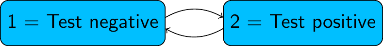

# Advanced phase-type models in msmbayes

To fit a model with non-exponential sojourn distributions (semi-Markov
model) in `msmbayes`, the easiest way is to use phase-type
approximations to Weibull and Gamma distributions, as explained in the
[vignette about this
technique](https://chjackson.github.io/msmbayes/articles/semimarkov.md).
These represent the sojourn distribution with two parameters - which may
be all that is possible to identify from data where the state is only
intermittently observed.

A more advanced approach to semi-Markov modelling in `msmbayes` is to
specify a phase-type distribution directly.

## Phase-type semi-Markov models

In a multi-state model, suppose we do not believe the sojourn time in a
particular state follows an exponential distribution. For example, in
the infection model, suppose we do not believe that the time spent in
the “test positive” state is exponential.



We can relax this assumption by building a **“semi-Markov”** model,
where the sojourn time in this state follows a more complex
distribution. One way to do this is to replace this state by a series of
two (or more) latent or hidden states, known as “phases”. For example,
with two phases:


> In a phase-type model, we allow progression from one phase to the
> next, but not transitions from later to earlier phases (or jumps
> between non-adjacent phases, if there are 3 phases or more).
> Otherwise, we allow the same transitions out of each phase as were
> allowed in the original model (to state 1, in this example)

We then assume transitions between and out of the phases follow
exponential distributions. That is, we assume a Markov model on the
latent state space. The test-positive state then has a sojourn
distribution known as the [“Coxian”
phase-type](https://en.wikipedia.org/wiki/Phase-type_distribution#Coxian_distribution)
distribution, instead of the exponential.

> **Note**: This is an example of a **hidden Markov model**, though one
> of a specific form where some states are observed correctly, and some
> states are latent. Phase-type models are a convenient way to build
> semi-Markov models for intermittently-observed data, because there are
> standard algorithms for computing the likelihood of a hidden Markov
> model.

## Fitting phase-type models in msmbayes

To assume a phase-type sojourn distribution for one or more states in a
`msmbayes` model, set the `nphase` argument. This is a vector of length
equal to the number of states, giving the number of phases per state.
Any elements of `nphase` that are 1 correspond to states with the usual
exponential sojourn distribution.

### Example: data simulated from a standard Markov model

Here we extend the 2-state model for the simulated infection data to
give state 2 (infection) a two-phase sojourn distribution. These data
were originally simulated assuming an exponential sojourn distribution
in state 2 (with rate 3). In this situation, we would expect the
estimated rates of transition out of each phase to be identical.

``` r

library(msmbayes)
```

``` r

Q <- rbind(c(0, 1), 
           c(1, 0))
draws <- msmbayes(infsim2, state="state", time="months", subject="subject",
                  Q=Q, nphase=c(1,2), fit_method = "optimize")
```

``` r

summary(draws)
```

    ## # A tibble: 6 × 7
    ##   name  from  to        posterior   mode prior_string                prior
    ##   <chr> <chr> <chr>    <rvar[1d]>  <dbl> <chr>                  <rvar[1d]>
    ## 1 q     1     2p1    0.74 ± 0.35  0.674  0.14 (0.0027, 6.8)   0.96 ± 4.4  
    ## 2 q     2p1   1      4.37 ± 2.08  3.99   0.14 (0.0027, 6.8)   0.96 ± 4.4  
    ## 3 q     2p1   2p2    0.32 ± 1.96  0.0382 0.14 (0.0027, 6.8)   0.96 ± 4.4  
    ## 4 q     2p2   1      7.43 ± 54.31 0.758  0.14 (0.0027, 6.8)   0.96 ± 4.4  
    ## 5 mst   1     NA     1.65 ± 0.77  1.48   7.4 (0.147, 372)    52.22 ± 237.6
    ## 6 mst   2     NA     0.30 ± 0.16  0.261  NA                     NA ± NA

The phased states are labelled specially here, e.g. the first phase of
state 2 is labelled `"2p1"`. The estimated transition rates from the two
phases of state 2 to state 1 are not significantly different from 2 -
but there is large uncertainty around the estimated rates, since this
model is over-fitted to the data. Implementing the same model in `msm`
would give extremely large confidence intervals around the estimated
rates.

### Example: data simulated from a phase-type model

The following code simulates a dataset from the following phase-type
model structure


with a transition intensity matrix (on the latent state space) given in
the R object `Qg`. This code uses the ability of the function
[`simmulti.msm()`](https://chjackson.github.io/msm/reference/simmulti.msm.html)
from the `msm` package to simulate from hidden Markov models.

``` r

Qg <- rbind(c(0, 0.18, 0.008, 0.012),
            c(0, 0,    0.016, 0.024),
            c(0, 0,    0,     0.2),
            c(0, 0,    0,     0))
E <- rbind(c(1,0,0,0), # hidden Markov model misclassification matrix
           c(1,0,0,0),
           c(0,1,0,0),
           c(0,0,1,0))
nsubj <- 10000; nobspt <- 10
set.seed(1)
sim.df <- data.frame(subject = rep(1:nsubj, each=nobspt),
                     time = seq(0, 100, length=nobspt))
library(msm)
sim.df <- simmulti.msm(sim.df[,1:2], qmatrix=Qg, ematrix=E)
```

We fit the phase-type model to the simulated data using both `msmbayes`
and `msm`.

The fast optimization-based method is used to approximate the Bayesian
posterior here, for speed of demonstration, but in practice we would
generally want to cross-check the results with MCMC. The posterior
distributions for these models are likely to have a skewed and
multimodal shape which is not represented well by a normal
approximation.

``` r

Q3 <- rbind(c(0,1,1),c(0,0,1),c(0,0,0))
draws <- msmbayes(data=sim.df, state="obs", time="time", subject="subject",
                  Q=Q3, nphase=c(2,1,1), fit_method="optimize")
bayesplot::mcmc_dens(draws, pars=sprintf("logq[%s]",1:6))
```


`msm` needs some tuning to converge, in particular the use of `fnscale`
and explicit initial values for the transition rate. In practice,
sensitivity analysis to these initial values would be needed to confirm
that the reported estimates are the global maximum likelihood estimates,
rather than one of the local maxima or saddle points.

``` r

Q3 <- rbind(c(0,0.5,0.5),c(0,0,0.5),c(0,0,0))
s.msm <- msm(obs ~ time, subject=subject, data=sim.df, phase.states=1, qmatrix=Q3,
             phase.inits=list(list(trans=0.05,  # seems to need these
                                   exit=matrix(rep(0.05,4),nrow=2,byrow=TRUE))),
             control = list(trace=1,REPORT=1,fnscale=50000,maxit=10000))
```

Reassuringly, the Bayesian and frequentist methods give similar
estimates of the transition intensities, which agree (within estimation
error) with the values used for simulation.

``` r

qmatrix(draws)
```

    ## rvar<4000>[4,4] mean ± sd:
    ##     1p1               1p2               2                 3                
    ## 1p1 -0.0413 ± 0.0025   0.0209 ± 0.0056   0.0098 ± 0.0044   0.0106 ± 0.0036 
    ## 1p2  0.0000 ± 0.0000  -0.2581 ± 0.0898   0.0973 ± 0.0569   0.1608 ± 0.0524 
    ## 2    0.0000 ± 0.0000   0.0000 ± 0.0000  -0.2012 ± 0.0062   0.2012 ± 0.0062 
    ## 3    0.0000 ± 0.0000   0.0000 ± 0.0000   0.0000 ± 0.0000   0.0000 ± 0.0000

``` r

qmatrix.msm(s.msm,ci="none")
```

    ##              State 1 [P1] State 1 [P2]     State 2    State 3
    ## State 1 [P1]   -0.1986608   0.17706760  0.01059025 0.01100295
    ## State 1 [P2]    0.0000000  -0.03930873  0.01593401 0.02337472
    ## State 2         0.0000000   0.00000000 -0.20150880 0.20150880
    ## State 3         0.0000000   0.00000000  0.00000000 0.00000000

``` r

Qg
```

    ##      [,1] [,2]  [,3]  [,4]
    ## [1,]    0 0.18 0.008 0.012
    ## [2,]    0 0.00 0.016 0.024
    ## [3,]    0 0.00 0.000 0.200
    ## [4,]    0 0.00 0.000 0.000

The mean sojourn times in states of a phase-type model can either be
calculated for the observable state space (`states="obs"`, the default),
or the latent state space (`states="phase"`).

``` r

mean_sojourn(draws)
```

    ## # A tibble: 2 × 3
    ##   state  posterior  mode
    ##   <int> <rvar[1d]> <dbl>
    ## 1     1  26 ± 1.44 27.7 
    ## 2     2   5 ± 0.15  4.97

``` r

mean_sojourn(draws, states="phase") 
```

    ## # A tibble: 3 × 5
    ##   state    posterior  mode stateobs statephase
    ##   <chr>   <rvar[1d]> <dbl>    <int>      <int>
    ## 1 1p1    24.3 ± 1.33 25.5         1          1
    ## 2 1p2     4.3 ± 1.46  4.23        1          2
    ## 3 2       5.0 ± 0.15  4.97        2          1

More practical experience of using general phase-type models for
intermittently-observed multi-state data is needed. In particular:

- How to specify substantive prior information. In the examples above,
  the default log-normal(-2,2) priors were used for transition
  intensities. But we need a better way to choose these based on
  judgements about interpretable quantities, e.g. the mean sojourn time
  in the phased state.

- Limited experience suggests that the Bayesian method is more likely
  than `msm` to produce a plausible result without the need for tuning.
  However, can the sampling algorithms always be relied upon?

- How to build and interpret models with covariates on intensities.
  Covariates can be placed on intensities for transitions in the phased
  state-space, but this has not been tested in practice. There is a risk
  of over-fitting, and strong constraints on covariate effects are
  expected to be necessary.

However, with intermittently-observed data, it is uncertain to what
extent we will be able to identify a detailed shape for the sojourn
distribution from the data. Therefore using [phase-type approximations
to shape-scale
distributions](https://chjackson.github.io/msmbayes/articles/semimarkov.md)
is expected to be a more useful approach to semi-Markov modelling.
