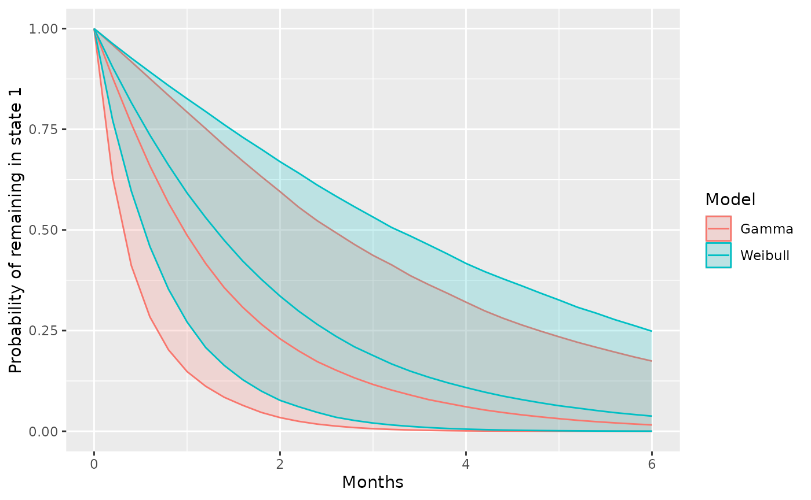

# Semi-Markov models with msmbayes

Non-Markov models have previously been difficult for intermittently
observed data, since we do not know the times of entry to the states.
For some transition structures, we may not even know whether or not any
particular transition took place within an interval between
observations. Hence it can be hard to discern how the hazard of
transition out of a state depends on the time spent in that state.

`msmbayes` makes these models easier to use. It can fit multi-state
models where the sojourn distribution in any state has a special
two-parameter distribution. This relaxes the Markov assumption,
producing a semi-Markov model, where the transition rate out of a state
depends on how long the individual has spent in the state. The sojourn
distribution used for these models is a *phase-type approximation to a
shape-scale distribution*, The phase-type approximation idea was
introduced by [Titman, 2014](https://doi.org/10.1007/s11222-012-9360-6).
`msmbayes` introduces an easier way to obtain the approximation, and
makes these models accessible for the first time. Full details are given
in [Jackson, 2026](https://doi.org/10.1016/j.csda.2026.108462).

`msmbayes` can also fit phase-type models directly - see [a separate
vignette](https://chjackson.github.io/msmbayes/articles/nphase.md) about
these. `msm` can also do this with two-phase models. However these are
awkward to use in practice for intermittently observed data. They have
several parameters, which are hard to interpret, and computation tends
to suffer from poor identifiability. By contrast, phase-type
approximations to shape-scale distributions have only two parameters,
and are based on well-understood parametric distributions.

## Phase-type shape-scale distributions

The distribution has two parameters: shape a and scale b. The
probability distribution function is defined by

F(x \| a, b) = F_p(x \| \boldsymbol{\lambda} = b \mathbf{h}(a))

where F_p(x \| \boldsymbol{\lambda}) is a phase-type distribution (with
5 phases by default) and vector of transition rates
\boldsymbol{\lambda}. The shape and scale are mapped to the phase-type
transition rates through a function \mathbf{h}(), determined so that the
first three moments of the phase-type distribution are the same as those
of the Weibull or a Gamma, for a wide range of shape parameters. This
function is pre-determined (using the formulae from [Bobbio et
al.](https://doi.org/10.1081/STM-200056210)) and stored in the
`msmbayes` package. A default of 5 phases is used. This process is
described more formally in [Jackson,
2026](https://doi.org/10.1016/j.csda.2026.108462).

- Covariates can be applied to the scale parameter b, as a linear model
  on \log(b), giving an accelerated failure time model.

- Additional assumptions are needed if there are multiple alternative
  states s that an individual can transition to immediately on leaving a
  state r that has a phase-type approximation. In `msmbayes`, this
  transition is governed by a constant “next state” probability
  \pi\_{rs}, as is done in [Titman,
  2014](https://doi.org/10.1007/s11222-012-9360-6). This assumes that
  the transition probability does not depend on the length of time spent
  in state r (the supplementary material to [Titman,
  2014](https://doi.org/10.1007/s11222-012-9360-6) discusses more
  flexible alternatives).

- Covariates can also be applied to \pi\_{rs} via a multiplicative model
  on the odds of transition.

## Implementation in msmbayes

This vignette gives a demonstration of using semi-Markov models with
phase-type shape-scale distributions in `msmbayes`, based on an
artificial dataset.

> **Note:** this vignette should not be used literally as a step-by-step
> recipe for an applied analysis. It is intended to demonstrate the
> range of functions available in the package and how to use them. An
> applied analysis should take account of the research question,
> including thoughtful choice of priors, computing appropriate outputs
> of interest, model checking and comparison.

### Specifying a basic semi-Markov model

To specify the states given a semi-Markov model, specify the `pastates`
argument to `msmbayes`, say `pastates=2` if this is state 2, or
`pastates=c(1,2)` if both states 1 and 2 are semi-Markov.

To start with, we fit a two-state infection model to the basic data
`infsim2` from the
[Examples](https://chjackson.github.io/msmbayes/articles/examples.md)
vignette. This is now made into a semi-Markov model. We compare a model
with the default Gamma approximation (in both states) to a model with a
Weibull for both states (setting the `pafamily` argument).

> If there is more than one state given a semi-Markov model, different
> distributions can be used for different states, e.g
> `pastates=c(1,2), pafamily=c("weibull","gamma")`.

``` r

library(msmbayes)
Q <- rbind(c(0,1), c(1,0))
drawsg <- msmbayes(data=infsim2, state="state", time="months", subject="subject",
                   pastates=1:2,
                   Q=Q, fit_method="optimize")
drawsw <- msmbayes(data=infsim2, state="state", time="months", subject="subject",
                   pastates=1:2, pafamily="weibull",
                   Q=Q, fit_method="optimize")
```

In this vignette, the Bayesian models are all fitted using posterior
mode optimisation and Laplace approximation (MCMC would be safer -
avoiding the risk of finding a local optimum or mis-estimating
uncertainty - but a lot slower).

#### Summarising shape parameters

Shape parameters around 1.0 (exponential distribution) are supported for
both states 1 and 2, indicating no evidence that the model is
semi-Markov. Indeed, the data were simulated with exponential sojourn
distributions.

Note that the `summary` method for `msmbayes` objects compares the
posterior distribution with the prior. The prior is summarised as a
string displaying the median and 95% credible interval, or an `rvar`
object containing a full posterior sample. See the [main msmbayes
vignette](https://chjackson.github.io/msmbayes/articles/examples.html#rvar)
for an explanation of the `rvar` format used in the column “posterior”
and how to summarise it.

``` r

summary(drawsg, pars="shape")
```

    ## # A tibble: 2 × 6
    ##   name  from   posterior  mode prior_string          prior
    ##   <chr> <chr> <rvar[1d]> <dbl> <chr>            <rvar[1d]>
    ## 1 shape 1       1 ± 0.38  1.03 1.0 (0.38, 2.66)  1.1 ± 0.6
    ## 2 shape 2       1 ± 0.44  1.01 1.0 (0.38, 2.66)  1.1 ± 0.6

``` r

summary(drawsw, pars="shape")
```

    ## # A tibble: 2 × 6
    ##   name  from    posterior  mode prior_string          prior
    ##   <chr> <chr>  <rvar[1d]> <dbl> <chr>            <rvar[1d]>
    ## 1 shape 1      1.0 ± 0.19  1.05 1.0 (0.61, 1.63)   1 ± 0.26
    ## 2 shape 2      1.1 ± 0.27  1.13 1.0 (0.61, 1.63)   1 ± 0.26

#### Choice of priors

When fitting these models, we used the default prior distributions. For
the shape parameters, the defaults are chosen to give flexible and
numerically stable model families based on the Weibull and Gamma. For
example, the default SD of the Weibull distribution was chosen to rule
out values for the shape parameter lower than about 0.6, for which the
phase-type approximation deviates from the Weibull and becomes
increasingly unstable as the shape decreases.

In a real application, instead of accepting the defaults, a better
approach to specifying priors is to draw random samples from priors and
transform these to more interpretable quantities (e.g. the mean sojourn
time) to determine what priors a given choice implies for those
interpretable quantities - starting with the defaults, and modifying by
trial and error if necessary.

A more detailed illustration of specifying priors informed by background
information is given in the appendix of [Jackson,
2026](https://doi.org/10.1016/j.csda.2026.108462).

#### Comparing the Gamma and Weibull

We can roughly compare the fit of these models through their
likelihoods. The mode of the log posterior (i.e. the maximum penalised
likelihood, with the priors considered as a penalty) essentially
measures in-sample predictive ability. For a multi-state model, that is
the ability to predict an individual’s next observation given their
current and previous observations. Since the two models being compared
here have the same number of parameters, and the priors are of similar
strength, any improvement in the likelihood would suggest better
generalisability. In this case, the maximum log posteriors for these two
models are very similar.

(Cross-validation would be a better way of comparing, but it is unclear
how that might be set up with an intermittently-observed multistate
model)

``` r

loglik(drawsg)
```

    ##       name    posterior        mode
    ## 1   loglik -144.5 ± 4.0 -142.234766
    ## 2 logprior   -6.5 ± 1.8   -5.372479
    ## 3  logpost -151.0 ± 5.3 -147.607245

``` r

loglik(drawsw)
```

    ##       name     posterior        mode
    ## 1   loglik -151.8 ± 66.1 -142.179576
    ## 2 logprior   -5.2 ± 5.9    -3.781163
    ## 3  logpost -157.0 ± 71.3 -145.960740

#### Sojourn distribution

The function
[`soj_prob()`](https://chjackson.github.io/msmbayes/reference/soj_prob.md)
computes the probability of staying in a given state, at a sequence of
times, from a fitted
[`msmbayes()`](https://chjackson.github.io/msmbayes/reference/msmbayes.md)
model. It can be used to plot a kind of “survival curve” for the sojourn
distribution in a state. In this case, there is little difference
between the Weibull and Gamma distributions, and a lot of uncertainty.

``` r

library(ggplot2)
library(dplyr)
t0 <- seq(0, 6, by=0.2)
spg <- soj_prob(drawsg,state=1,t=t0) |> mutate(Model="Gamma")
spw <- soj_prob(drawsw,state=1,t=t0) |> mutate(Model="Weibull")
sp <- rbind(spg, spw)
summary(sp) |> 
  ggplot(aes(x=time, y=median, col=Model)) + 
  geom_ribbon(aes(ymin=q5, ymax=q95, fill=Model), alpha=0.2) +
  geom_line() + 
  xlab("Months") + ylab("Probability of remaining in state 1")
```



The mean of the sojourn distribution, the mean time to the next
transition on entry to a state, is given by
[`mean_sojourn()`](https://chjackson.github.io/msmbayes/reference/mean_sojourn.md).
The mean of the phase-type approximation should agree with the mean of
the distribution that it was based on, since the approximation was
designed to match the first three moments. This is verified here for the
Gamma distribution, which has mean defined by `shape x scale`.

``` r

mean_sojourn(drawsg)
```

    ## # A tibble: 2 × 3
    ##   state    posterior  mode
    ##   <int>   <rvar[1d]> <dbl>
    ## 1     1  1.65 ± 1.01 1.52 
    ## 2     2  0.27 ± 0.16 0.262

``` r

shape <- summary(drawsg, pars="shape")
scale <- summary(drawsg, pars="scale")
shape$posterior * scale$posterior
```

    ## rvar<4000>[2] mean ± sd:
    ## [1] 1.65 ± 1.01  0.27 ± 0.16

### Specifying a semi-Markov model with covariates

We now extend the Gamma model to include a covariate (binary,
representing sex) on the scale parameter for the distribution in both
states. The log likelihood hardly changes, as we might expect, as there
was no covariate effect assumed when the data were simulated, so this
model includes a lot of extra unnecessary parameters.

The prior for the shape parameter in this example is tightened to
support a slightly smaller range of values (up to `exp(2*0.4) = 2.2`).
With the default prior SD of 0.5, the optimisation fails to converge,
likely due to weak identifiability. We see in the posterior summary that
in fact the posteriors for the shape parameters are similar to the
priors, indicating weak information in the data about these parameters.

``` r

drawsc <- msmbayes(data=infsim2, state="state", time="months", subject="subject",
                   pastates=1:2,
                   priors = list(msmprior("logshape", mean=0, sd=0.4)),
                   covariates = list(scale(1) ~ male, scale(2) ~ male),
                   Q=Q, fit_method="optimize")
```

    ## Warning in .local(object, ...): non-zero return code in optimizing

``` r

loglik(drawsc)
```

    ##       name   posterior      mode
    ## 1   loglik -150 ± 17.6 -142.1279
    ## 2 logprior  -12 ± 1.3   -11.0203
    ## 3  logpost -162 ± 17.7 -153.1482

``` r

summary(drawsc, pars = "shape")
```

    ## # A tibble: 2 × 6
    ##   name  from    posterior  mode prior_string           prior
    ##   <chr> <chr>  <rvar[1d]> <dbl> <chr>             <rvar[1d]>
    ## 1 shape 1      1.1 ± 0.36 1.04  1.0 (0.46, 2.19)  1.1 ± 0.45
    ## 2 shape 2      1.0 ± 0.14 1.000 1.0 (0.46, 2.19)  1.1 ± 0.45

#### Time acceleration factors

The covariate effects in this model can be summarised as “time
acceleration factors”. In this case, their posterior distributions cover
a very wide interval, indicating a lack of information in the data and
no evidence for an effect in either direction.

> Note the use of the [`summary()`](https://rdrr.io/r/base/summary.html)
> function on the object returned by
> [`taf()`](https://chjackson.github.io/msmbayes/reference/logtaf.md),
> which applies a user-specified summary to the `posterior` column of
> this object, as explained
> [here](https://chjackson.github.io/msmbayes/articles/examples.html#rvar)).
> Note also `taf(...)` is an alternative to `summary(..., pars="taf")`.

``` r

taf(drawsc)
```

    ##   from name posterior     mode
    ## 1    1 male   15 ± 62 2.751458
    ## 2    2 male   13 ± 50 2.531223

``` r

summary(taf(drawsc), ~quantile(.x, c(0.025, 0.5, 0.975)))
```

    ##   from name     mode       2.5%      50%    97.5%
    ## 1    1 male 2.751458 0.08012185 2.917579 115.1142
    ## 2    2 male 2.531223 0.07008792 2.584790 106.7616

#### Outputs from fitted models by covariates

All standard multistate model outputs are supported for semi-Markov
models as for Markov models.

- Transition intensities
  ([`qdf()`](https://chjackson.github.io/msmbayes/reference/qdf.md),
  [`qmatrix()`](https://chjackson.github.io/msmbayes/reference/qmatrix.md))
  for semi-Markov models are only defined on the latent space of
  “phases” rather than observable states.

- Transition probabilities over any time interval
  ([`pmatrixdf()`](https://chjackson.github.io/msmbayes/reference/pmatrixdf.md),[`pmatrix()`](https://chjackson.github.io/msmbayes/reference/pmatrix.md))
  are available on the space of observable or latent states. For
  observable states (the default) this describes the probability of
  transitioning to *any* phase of each “destination” state (summing over
  phases within a state), for a person in the *first* phase of each
  “starting” state.

- Mean sojourn times
  [`mean_sojourn()`](https://chjackson.github.io/msmbayes/reference/mean_sojourn.md),
  or the total length of stay
  [`totlos()`](https://chjackson.github.io/msmbayes/reference/totlos.md)
  can be produced for either the observable states or the latent phases.

For example, the total length of time spent in each observable state,
over 12 months, is computed here for two different covariate values (men
and women). If `nd` is not supplied, the output is returned for
covariate values of zero.

``` r

nd <- data.frame(male=c(0,1))
totlos(drawsc, t=12, new_data=nd)
```

    ## # A tibble: 4 × 4
    ## # Groups:   state [2]
    ##   state    posterior  male  mode
    ##   <int>   <rvar[1d]> <dbl> <dbl>
    ## 1     1  10.2 ± 0.41     0 10.3 
    ## 2     1  10.1 ± 0.46     1 10.2 
    ## 3     2   1.8 ± 0.41     0  1.66
    ## 4     2   1.9 ± 0.46     1  1.81

Or for a standard population whose distribution matches the observed
distribution of covariates in the data frame `nd`, here 50% men and 50%
women:

``` r

totlos(drawsc, t=12, new_data=standardise_to(nd))
```

    ## # A tibble: 2 × 3
    ##   state    posterior  mode
    ##   <int>   <rvar[1d]> <dbl>
    ## 1     1  10.2 ± 0.44 10.2 
    ## 2     2   1.8 ± 0.44  1.77

We may also break down the total length of time spent in each of the
five latent phases that comprise a stay in state 1 or state 2, though
this is only of academic interest. These are the states of the hidden
Markov model that is used to implement the semi-Markov model.

``` r

totlos(drawsc, t=12, states="phase")
```

    ## # A tibble: 6 × 5
    ##   state     posterior      mode stateobs statephase
    ##   <chr>    <rvar[1d]>     <dbl>    <int>      <int>
    ## 1 1p1    8.02 ± 1.523 10.0             1          1
    ## 2 1p2    1.18 ± 0.738  0.150           1          2
    ## 3 1p3    1.02 ± 0.611  0.144           1          3
    ## 4 2p1    1.55 ± 0.404  1.66            2          1
    ## 5 2p2    0.12 ± 0.099  0.000495        2          2
    ## 6 2p3    0.11 ± 0.096  0.000483        2          3

### Semi-Markov models with competing risks

This is based on the dataset `illdeath_data`, a simulated dataset with
three states representing health, illness and death. Death is allowed
from either living state, and no recovery from the illness is assumed.

State 1 is given a semi-Markov model with `pastates`. There are
“competing risks”, since on leaving state 1, an individual can either
get the illness or die without the illness. The binary covariate “sex”
modifies both the scale parameter for the sojourn time in state 2
(illness), the chance of moving to 3 (rather than 2) on leaving 1, and
the rate of transition from illness to death.

> **Note** If the state, time and subject variables are called “state”,
> “time”, and “subject”, we do not need to name them explicitly in the
> call to
> [`msmbayes()`](https://chjackson.github.io/msmbayes/reference/msmbayes.md).

``` r

Qid <- rbind(c(0,1,1), c(0,0,1), c(0,0,0))
draws <- msmbayes(data=illdeath_data, pastates=1,
                  covariates = list(scale(1) ~ sex,
                                    rrnext(1,3) ~ sex,
                                    Q(2,3) ~ sex),
                  Q=Qid, fit_method="optimize")
```

This model is a combination of a semi-Markov model for the transition
out of state 1, and a Markov model for the transition out of state 2,
with a phase-type approximation and exponential sojourn distributions
respectively.

#### Summarising covariate effect parameters

The effects of covariates on progression are represented differently for
each of these states. For the risk of death from illness, the covariate
effect is a hazard ratio.

``` r

summary(draws, pars="hr")
```

    ##          name from to posterior     mode   prior_string             prior
    ## 1 hr(sexmale)    2  3 1.6 ± 1.3 1.310946 1 (0, 3.2e+08) 4.3e+11 ± 2.2e+13
    ## 2 hr(sexmale)    2  3 1.6 ± 1.3 1.310946 1 (0, 3.2e+08) 4.3e+11 ± 2.2e+13

For a person in state 1, without the illness, there are two aspects of
the covariate effect.

- A time acceleration factor `taf`, representing the effect of time on
  the length of stay in state 1. A bigger `taf` speeds up time, so that
  an effect size of 2 halves the expected time to the next transition.
  For the exponential distribution, this parameter has the same
  interpretation as the hazard ratio.

- The multiplicative effect `rrnext` on the relative risk of death
  without the illness, relative to a “baseline” risk of getting the
  illness.

``` r

summary(draws, pars=c("taf","rrnext"))
```

    ##              name from to posterior     mode   prior_string             prior
    ## 1    taf(sexmale)    1 NA 1.4 ± 1.1 1.089602 1 (0, 3.2e+08) 4.3e+11 ± 2.2e+13
    ## 2 rrnext(sexmale)    1  3 3.0 ± 5.7 1.314298 1 (0, 3.2e+08) 4.3e+11 ± 2.2e+13

#### Summarising outputs by covariates

As covariates may influence the progression through the multi-state
system in many ways, how we build and summarise the model will depend on
the research question.

A useful general approach is compute an outcome of interest and compare
it between different covariate values. As an illustration, in this
model, suppose we are interested in the total time spent alive over 24
months for a person at the start of the study. First this is computed
for each covariate category to be compared (using
[`standardise_to()`](https://chjackson.github.io/msmbayes/reference/standardise_to.md)
as above, if necessary, to marginalise over other covariates).

``` r

tl <- totlos(draws, t=24, new_data = data.frame(sex=c("male","female")))
tl
```

    ## # A tibble: 6 × 4
    ## # Groups:   state [3]
    ##   state     posterior sex      mode
    ##   <int>    <rvar[1d]> <chr>   <dbl>
    ## 1     1   0.89 ± 0.32 female  0.895
    ## 2     1   0.73 ± 0.29 male    0.740
    ## 3     2   1.33 ± 0.66 female  1.29 
    ## 4     2   0.91 ± 0.49 male    0.878
    ## 5     3  21.78 ± 0.72 female 21.8  
    ## 6     3  22.36 ± 0.57 male   22.4

Posterior samples are then extracted for the time in state 1 and the
time in state 2 separately, for men and women separately. `tl_12_male`
(and `tl_12_female`) will then comprise two `rvar` objects.

``` r

tl_12_male <- tl |> filter(state %in% 1:2, sex=="male") |> pull(posterior) 
tl_12_female <- tl |> filter(state %in% 1:2, sex=="female") |> pull(posterior)
tl_12_male
```

    ## rvar<4000>[2] mean ± sd:
    ## [1] 0.73 ± 0.29  0.91 ± 0.49

The posterior samples for state 1 and state 2 are added together to give
the posterior sample for the time spent alive. This is done for women
and men separately. Note `rvar_sum` is needed for this, not the standard

Finally we obtain a posterior sample `tl_diff` for the difference in the
expected time spent alive for men and women.

``` r

library(posterior)
tl_diff <- rvar_sum(tl_12_female) - rvar_sum(tl_12_male) 
```

> **Note:**
> [`rvar_sum()`](https://mc-stan.org/posterior/reference/rvar-summaries-within-draws.html)
> from the `posterior` package is needed to add the “random variables”
> represented by rvar objects, producing a random variable representing
> their sum. The base R [`sum()`](https://rdrr.io/r/base/sum.html)
> function would collapse the samples inside the rvar objects to produce
> a scalar, which is not what we want here.

A null hypothesis test for whether an effect is “significant” does not
have a direct analogue in Bayesian analysis. Instead I would recommend
summarising the posterior distribution of a quantity of interest. This
might be done in different ways, e.g. as a 95% credible interval, or a
posterior probability of exceeding a value of practical interest
(e.g. 0, or a clinically important value):

``` r

summary(tl_diff, ~quantile(.x, c(0.025, 0.5, 0.975)))
```

    ## # A tibble: 1 × 4
    ##   variable `2.5%` `50%` `97.5%`
    ##   <chr>     <dbl> <dbl>   <dbl>
    ## 1 tl_diff   -1.16 0.554    2.53

``` r

mean(tl_diff > 0)
```

    ## [1] 0.747
